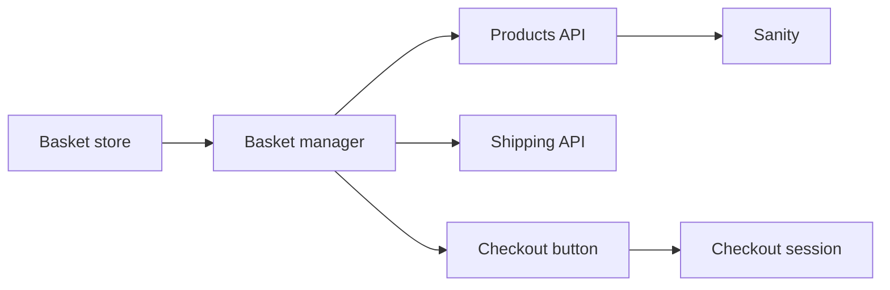

# Cart
Client-side cart kept in a persisted zustand store and shown on `/basket` with product data and stock read from Sanity and a shipping-rate estimate.

## Architecture

## How it works
- `features/basket/state/basketStore.ts` holds items of `productId` and a positive integer `quantity`, persisted under `basket-storage` through localStorage and sessionStorage; only `items` is persisted.
- `app/(store)/basket/page.tsx` renders `features/checkout/ui/BasketCheckout.tsx`, which renders `features/basket/ui/BasketManager.tsx`.
- `BasketManager.tsx` loads product data with SWR from `app/api/basket/products/route.ts`, which runs the Sanity query in `features/basket/adapters/sanity/fetchBasketProducts.ts`; `features/basket/queries/getBasketProducts.ts` drops products without `_id`, name or `unit_amount`.
- Available stock is `stock - reservedStock`; `BasketManager.tsx` shows at most that quantity and `features/basket/ui/BasketControls.tsx` stops the quantity at it.
- `BasketManager.tsx` posts one parcel per unit to `app/api/basket/shipping-rates/route.ts` after a 500 ms debounce; the route calls `getCheapestShippingRate` from `features/shipping`.
- `features/checkout/ui/CheckoutButton.tsx` calls `initCheckoutSessionAction`.

## Under construction
- No basket tests: `tests/` holds only `catalogue`, `product-filtering` and `products`.
