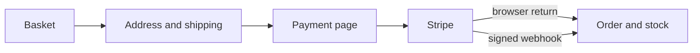

[Next: Cart](../basket/README.md)
# Checkout system
Checkout flow over address, shipping, payment and success pages that keeps its state in a cookie session, takes payment through Stripe and writes the order to Sanity.

## Architecture

## How it works
- Pages `app/checkout/{address,shipping,payment,success}/page.tsx`; `app/checkout/page.tsx` redirects to `/checkout/address`.
- State lives in the iron-session cookie `checkout_session` (httpOnly, 1 hour) in `features/checkout/adapters/iron-session/checkoutSession.ts`; it throws if `SESSION_SECRET` is unset.
- `features/checkout/actions/saveAddressAction.ts` saves the address only when `checkAddress` returns `ACCEPT` and clears the saved shipping choice; `saveShippingAction.ts` saves the shipping choice.
- `features/checkout/commands/createPaymentIntent.ts` recomputes the total from Sanity unit prices, the session quantities and the session shipping cost, then creates or updates the Stripe intent (currency `pln`, `features/checkout/adapters/stripe/client.ts`). The client total is range-checked and then ignored.
- Two paths place the order: `features/checkout/commands/handlePaymentReturn.ts` (browser return to `/api/checkout/return`; it asks Stripe for the status and the payment id must match the session) and `features/checkout/commands/handlePaymentWebhook.ts` (`/api/webhooks/stripe`, signature checked, 500 on order failure).
- `features/order/adapters/sanity/createOrderFromPayment.ts` skips an existing order, then creates `order_<paymentIntentId>` and decrements stock in one Sanity transaction; `features/checkout/commands/placeOrderFromPayment.ts` then sends the confirmation email.

## Proofs
- Two questions: parity (the customer is charged the shelf price, and one payment becomes exactly one order for that amount and those goods) and conservation (orders and stock together explain every unit, and a unit missing from the shelf is recorded on the order).
- Run: `node --experimental-strip-types --import ./tools/alias-loader.mjs --import ./tests/checkout/load.mjs tests/checkout/payment-order.test.ts`. Exit 0 means every line passed, 1 means the shop failed a line, 2 means the proof itself broke.
- The proof calls the shop's real code. Stripe and Sanity are stand-ins in `tests/checkout/card-provider.test.ts` and `tests/checkout/stock-book.mjs`. The situations and their written totals are in `tests/checkout/domain.mjs`. Nothing waits, rolls dice or leaves the machine.
- Before the shop is asked, rulers check that the written totals add up and that the stand-ins obey their rules. `tests/checkout/holds.test.ts` checks that a sentence reads the same twice and that wrong paperwork is never called a pass.
- About 45 smaller files in `tests/checkout/` each prove one customer-visible sentence (wording, dates, phone, refusals, redirects). Run one with `node --experimental-strip-types tests/checkout/<name>.test.ts`.
- Nothing runs these proofs automatically: CI runs only `tools/check-turn.mjs --all`.

## Under construction
- A basket whose text is 451 to 500 characters is charged, then the order is refused: `createPaymentIntent.ts` allows 500, `createOrderFromPayment.ts` throws above 450. The proof has no situation in that range.
- A quantity above stock is allowed at payment (only stock 0 is refused). The order records `fulfilled` below the paid quantity, and the customer has been charged in full. No refund or alert exists.
- No code sets the customer email or `receipt_email`, so the confirmation email has no recipient.
- A paid payment with no order has no sweep. Failed and canceled webhooks are only logged.
- The Stripe and Sanity stand-ins are not checked against the real services.
