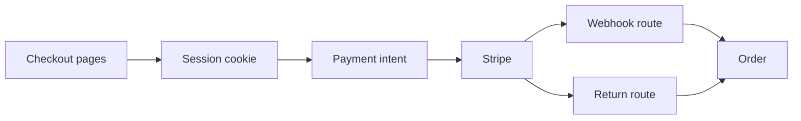

[Next: Cart](../basket/README.md)
# Checkout system
Checkout flow over address, shipping, payment and success pages that keeps its state in a cookie session, takes payment through Stripe and writes the order to Sanity.

## Architecture

## How it works
- Pages `app/checkout/{address,shipping,payment,success}/page.tsx`; `app/checkout/page.tsx` redirects to `/checkout/address`.
- State lives in the iron-session cookie `checkout_session` (httpOnly, 1 hour) in `features/checkout/adapters/iron-session/checkoutSession.ts`; it throws if `SESSION_SECRET` is unset.
- `features/checkout/actions/saveAddressAction.ts` saves the address only when `checkAddress` returns `ACCEPT` and clears the saved shipping choice; `saveShippingAction.ts` saves the shipping choice.
- `features/checkout/commands/createPaymentIntent.ts` recomputes the total from Sanity unit prices, the session quantities and the session shipping cost, then creates or updates the Stripe intent (currency `pln`, `features/checkout/adapters/stripe/client.ts`).
- Two paths place the order: `features/checkout/commands/handlePaymentReturn.ts` (browser return to `/api/checkout/return`) and `features/checkout/commands/handlePaymentWebhook.ts` (`/api/webhooks/stripe`, signature checked, 500 on order failure).
- `features/order/adapters/sanity/createOrderFromPayment.ts` skips an existing order, then creates `order_<paymentIntentId>` and decrements stock in one Sanity transaction; `features/checkout/commands/placeOrderFromPayment.ts` then sends the confirmation email.

## Under construction
- No checkout tests: `tests/` holds only `catalogue`, `product-filtering` and `products`.
