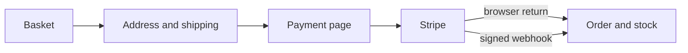

[Next: Cart](../basket/README.md)
# Checkout system
Checkout flow over address, shipping, payment and success pages that keeps its state in a cookie session, takes payment through Stripe and writes the order to Sanity.

## Architecture

## How it works
- Pages `app/checkout/{address,shipping,payment,success}/page.tsx`; `app/checkout/page.tsx` redirects to `/checkout/address`.
- State lives in the iron-session cookie `checkout_session` (httpOnly, 1 hour) in `features/checkout/adapters/iron-session/checkoutSession.ts`; it throws if `SESSION_SECRET` is unset.
- `features/checkout/actions/saveAddressAction.ts` saves the address only when `checkAddress` returns `ACCEPT` and clears the saved shipping choice; `saveShippingAction.ts` saves the shipping choice.
- `features/checkout/commands/createPaymentIntent.ts` recomputes the total from Sanity unit prices, the session quantities and the session shipping cost, then creates or updates the Stripe intent (currency `pln`, `features/checkout/adapters/stripe/client.ts`). The client total is range-checked and then ignored.
- Two paths place the order: `features/checkout/commands/handlePaymentReturn.ts` (browser return to `/api/checkout/return`; it asks Stripe for the status and the payment id must match the session) and `features/checkout/commands/handlePaymentWebhook.ts` (`/api/webhooks/stripe`, signature checked, 500 on order failure).
- `features/order/adapters/sanity/createOrderFromPayment.ts` skips an existing order, then creates `order_<paymentIntentId>` and decrements stock in one Sanity transaction; `features/checkout/commands/placeOrderFromPayment.ts` then sends the confirmation email.

## Proofs
- [proof-book.md](proof-book.md) lists what can go wrong with money, goods and failures, and answers each with a proof line, or with "cannot happen" or "out of scope" and the reason. Known open holes are listed there too.
- Run all of it with `npm run proof:checkout`. Exit 0 means every line passed, 1 means the shop failed a line, 2 means the proof itself broke. CI runs it on every pull request and every push to main.
- The other files in `tests/checkout/` each prove one customer-visible sentence (wording, dates, phone, redirects). Run one with `node --experimental-strip-types tests/checkout/<name>.test.ts`.